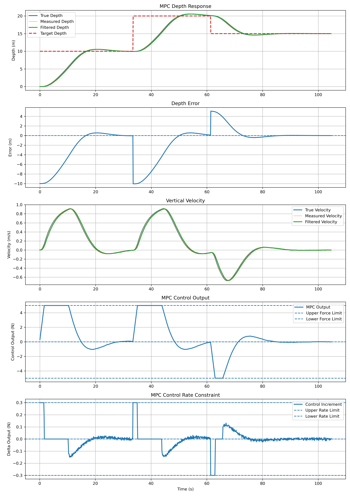

# MPC ROS2 Gazebo AUV Control

## 项目简介

本项目基于 **ROS2 Humble、Gazebo、C++ 和 MPC** 搭建 AUV 深度控制仿真系统。

在完成 PID、LQR 控制学习的基础上，进一步使用 Eigen 构建 MPC 预测模型，并通过 **OSQP / OsqpEigen** 在线求解带约束的二次规划问题，将控制算法接入 Gazebo，实现真实受力闭环。

项目主要完成了：

- C++ 实现 MPC 控制器
- OSQP 在线求解最优控制量
- Gazebo 深度与垂向速度反馈
- 控制输出转换为 Gazebo 外力
- 测量噪声与低通滤波
- 控制力约束：`-5 N ≤ u ≤ 5 N`
- 控制变化率约束：`|Δu| ≤ 0.3 N/step`
- 固定目标深度跟踪
- 多目标深度跟踪
- 外部扰动响应实验
- Python 数据处理与实验结果绘图

---

## 控制结构

```text
Target Depth
     ↓
MPC Controller
     ↓
Control Output
     ↓
Gazebo Force Node
     ↓
AUV
     ↓
Depth / Velocity Feedback
     └──────────────→ MPC
```

MPC 根据当前深度误差和垂向速度预测未来状态，通过优化得到控制序列，每个控制周期只执行第一个控制量，并重新进行下一次预测与优化。

控制器中加入：

```text
Control Force:
-5 N ≤ u ≤ 5 N

Control Increment:
|Δu| ≤ 0.3 N/step
```

---

# 实验结果

## 1. 固定目标深度跟踪

首先进行 20 m 固定目标深度实验，用于验证 MPC 的基本跟踪能力以及控制约束。

实验过程中，AUV 从初始位置下潜到目标深度，控制输出首先达到推力上限，随后随着误差减小逐渐降低，最终稳定在目标深度附近。

同时验证：

- 深度能够稳定跟踪目标值
- 控制力始终满足 ±5 N 限制
- 控制量变化始终满足 ±0.3 N/step 限制
- 加入测量噪声后，滤波结果能够保持稳定

实验图主要包括：

```text
Depth Response
Depth Error
Vertical Velocity
MPC Control Output
Control Increment
Measurement Noise and Filtering
```

固定目标实验综合图：

```markdown

```

---

## 2. 多目标深度跟踪

在固定目标实验基础上，将目标深度设置为：

```text
10 m → 20 m → 15 m
```

用于测试 MPC 在参考目标发生变化时的重新预测和跟踪能力。

实验中可以观察到：

- 目标从 10 m 切换到 20 m 后，MPC重新增加控制输出并继续下潜
- 目标从 20 m 切换到 15 m 后，控制输出改变方向，使 AUV 上浮
- 每次目标变化后，深度误差均能够重新收敛
- 整个过程中控制力和控制变化率约束仍然有效

多目标实验综合图：

```markdown

```

该实验主要验证了 MPC 对变化参考输入的跟踪能力。

---

## 3. 外部扰动实验

为了进一步测试控制器在外部干扰下的表现，在 AUV 稳定于 20 m 附近后加入外部扰动力。

实验设置：

| 参数 | 设置 |
|---|---|
| Target Depth | 20 m |
| Disturbance Start | 40 s |
| Disturbance End | 50 s |
| Disturbance Force | 2 N downward |
| Force Limit | ±5 N |
| Rate Limit | ±0.3 N/step |

40～50 s 内施加 2 N 向下扰动力。

扰动加入后，AUV 深度发生偏移，MPC通过状态反馈逐渐产生反方向控制作用；扰动撤除后，控制器继续调整控制量，并最终使 AUV 返回目标深度附近。

该实验中 MPC 本身并不知道外部扰动力的具体大小，而是根据状态变化重新计算控制输入。

外部扰动实验综合图：

```markdown

```

图中阴影区域表示外部扰动作用时间。

---

## 实验总结

| 实验 | 工况 | 主要验证内容 |
|---|---|---|
| Fixed Target | 20 m | MPC基本跟踪能力 |
| Variable Target | 10 → 20 → 15 m | 多目标跟踪与重新优化 |
| External Disturbance | 20 m + 2 N disturbance | 外部扰动后的恢复能力 |
| Force Constraint | ±5 N | 执行器幅值约束 |
| Rate Constraint | ±0.3 N/step | 控制变化率约束 |
| Noise Test | Depth / Velocity Noise | 测量噪声与滤波 |

通过三组实验，可以看到 MPC 不仅能够完成基本深度跟踪，还能够在目标变化、执行器约束和外部扰动存在的情况下继续进行闭环控制。

---

# 主要程序

```text
src/auv_mpc_ros/src/

mpc_controller_node.cpp
    MPC控制器
    预测矩阵构建
    QP问题构建
    OSQP在线求解
    控制约束处理

force_depth_feedback_node.cpp
    获取Gazebo真实深度
    获取垂向速度
    加入测量噪声
    进行低通滤波

gazebo_force_node.cpp
    将MPC控制输出转换为Gazebo外力
    加入垂向阻尼

gazebo_force_disturbance_node.cpp
    在普通受力模型基础上加入外部扰动力
    用于MPC抗扰动实验
```

主要 Launch 文件：

```text
auv_mpc_launch.py
    固定目标深度实验

auv_mpc_variable_target_launch.py
    10 m → 20 m → 15 m 多目标跟踪实验

auv_mpc_disturbance_launch.py
    20 m目标深度 + 外部扰动实验
```

---

# 编译与运行

## 编译

```bash
cd ~/MPC_ros_gazebo_auv_project

source /opt/ros/humble/setup.bash

colcon build --symlink-install

source install/setup.bash
```

## 固定目标 MPC

```bash
ros2 launch auv_mpc_ros auv_mpc_launch.py
```

## 多目标跟踪

```bash
ros2 launch auv_mpc_ros auv_mpc_variable_target_launch.py
```

目标变化：

```text
10 m → 20 m → 15 m
```

## 外部扰动实验

```bash
ros2 launch auv_mpc_ros auv_mpc_disturbance_launch.py
```

扰动设置：

```text
40 ~ 50 s
2 N downward disturbance
```

---

# 数据处理

实验过程中将深度、速度、误差和控制输出保存为 CSV 文件，并使用 Python 进行结果分析。

主要数据包括：

```text
time
target_depth
current_depth
measured_depth
filtered_depth
velocity
measured_velocity
filtered_velocity
error
output
```

绘图内容包括：

```text
Target / True / Measured / Filtered Depth
Depth Error
Vertical Velocity
MPC Control Output
Control Increment
External Disturbance
```

运行绘图程序：

```bash
python3 plot_mpc_variable_target.py
```

或：

```bash
python3 plot_mpc_disturbance.py
```

---

# 学习与体会

通过这个项目，我对 MPC 的理解从最开始的公式、状态空间模型和矩阵计算，逐渐转变成了一个真正能够在 ROS2 和 Gazebo 中运行的控制系统。

在实现过程中，我进一步理解了预测模型、状态权重、控制权重、预测时域以及控制约束之间的关系，也理解了为什么 MPC 可以直接把执行器幅值和控制变化率限制加入优化问题。

相比单纯在 MATLAB 中观察控制曲线，这个项目让我更加关注整个闭环系统，包括 Gazebo 状态反馈、ROS2 Topic 通信、坐标方向、外力施加、测量噪声、滤波以及控制节点之间的配合。

在外部扰动实验中，我也认识到仿真不能只看最终曲线是否正常，还需要检查扰动力是否真正施加、实验时间是否对应以及控制输出是否符合物理规律。

通过这个过程，我开始从单纯“把控制算法运行起来”，逐渐转向理解控制算法如何真正接入机器人仿真系统。

后续希望继续在现有 ROS2、Gazebo 和 C++ 基础上学习机械臂运动学、轨迹规划以及机械臂控制，并进一步提高控制算法的工程实现能力。
