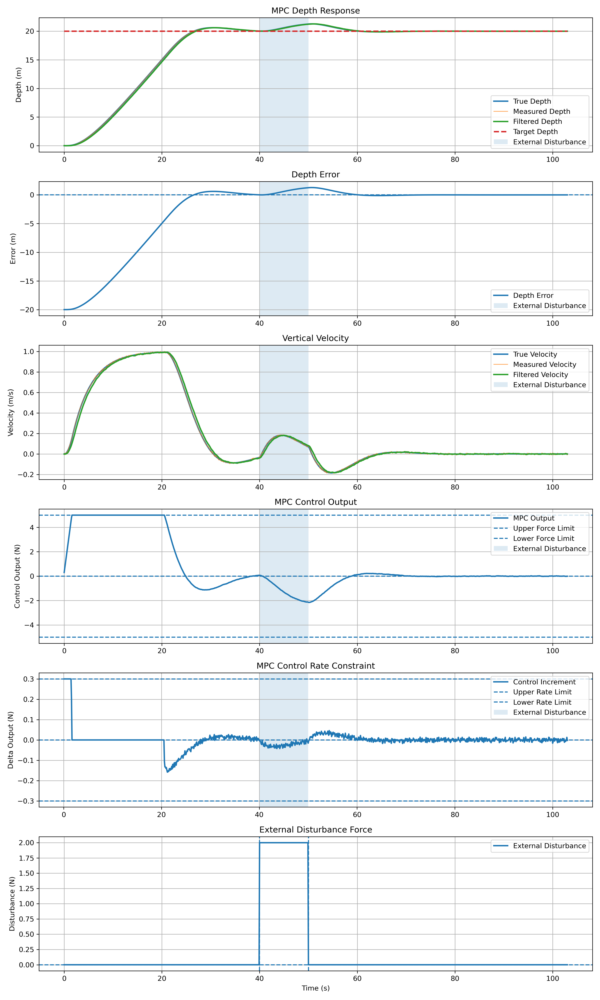

# MPC ROS2 Gazebo AUV Control

## 项目简介

本项目基于 **ROS2 Humble、Gazebo、C++ 和 MPC** 实现 AUV 深度控制仿真。

在此前 PID 和 LQR 控制实现的基础上，进一步使用 Eigen 构建 MPC 预测模型，并通过 **OSQP / OsqpEigen** 在线求解带约束的二次规划问题，将控制器接入 Gazebo 真实受力闭环。

项目中主要完成：

- C++ 实现 MPC 控制器
- 构建状态预测模型和 MPC 优化矩阵
- 使用 OSQP 在线求解控制序列
- Gazebo 深度、垂向速度反馈
- 控制输出转换为 Gazebo 外力
- 加入测量噪声与低通滤波
- 控制力约束：`±5 N`
- 控制变化率约束：`±0.3 N/step`
- PID、LQR、MPC 三种算法对比
- 固定目标深度实验
- 多目标深度跟踪实验
- 外部扰动实验
- CSV 数据保存与 Python 绘图分析

---

## 控制结构

```text
Target Depth
     ↓
MPC Controller
     ↓
OSQP Optimization
     ↓
Control Output
     ↓
Gazebo Force Node
     ↓
AUV
     ↓
Depth / Velocity Feedback
     └──────────────→ MPC
```

MPC 根据当前深度误差和垂向速度预测未来状态，在满足控制约束的情况下计算最优控制序列，并只执行当前时刻的第一个控制量。

控制约束：

```text
-5 N ≤ u ≤ 5 N

|Δu| ≤ 0.3 N/step
```

---

# 实验内容

## 1. 固定目标深度实验

首先设置目标深度为：

```text
20 m
```

测试 MPC 的基本跟踪能力。

实验中主要观察：

- Target / Current Depth
- Depth Error
- Vertical Velocity
- MPC Control Output
- Control Increment
- Measurement / Filtered Signal

AUV 能够逐渐到达目标深度，并最终稳定在 20 m 附近。

同时控制输出始终满足：

```text
|u| ≤ 5 N

|Δu| ≤ 0.3 N/step
```

---

## 2. PID / LQR / MPC 对比实验

为了比较不同控制算法的特点，将 **PID、LQR 和 MPC** 放入相同 Gazebo 受力环境中进行测试。

三种算法采用相同的：

```text
AUV Model
Target Depth
Force Limit
Control Rate Limit
Gazebo Environment
```

并统一截取 `0 ~ 75.2 s` 数据进行比较。

### 对比结果

| 指标 | PID | LQR | MPC |
|---|---:|---:|---:|
| Rise Time / s | 未达到 | 18.6 | 17.5 |
| First Target / s | 未达到 | 33.6 | 26.7 |
| Settling Time / s | 未达到 | 29.5 | 34.0 |
| Maximum Depth / m | 17.749 | 20.072 | 20.584 |
| Overshoot | — | 0.358% | 2.921% |
| Final Error / m | 2.251 | 0.007 | 0.002 |
| RMSE / m | 10.209 | 7.667 | 7.635 |
| Maximum Control / N | 3.589 | 5.000 | 5.000 |
| Maximum Δu / N | 0.300 | 0.300 | 0.300 |
| Control Energy | 159.45 | 468.83 | 524.45 |

> PID 在统一实验时间内没有到达目标深度，因此其超调量不能作为性能优势进行比较。

从实验中可以直观看到三种控制方法的不同特点：

```text
PID
主要依据当前和历史误差进行反馈控制，
结构简单，但当前参数下跟踪速度较慢。

LQR
同时利用深度误差和垂向速度进行状态反馈，
超调较小，控制效果较稳定。

MPC
通过预测未来状态进行在线优化，
能够直接处理控制力和控制变化率约束，
同时具有较快的目标跟踪能力。
```

通过这一实验，我对 PID、LQR 和 MPC 从控制结构到实际响应的区别有了更加直观的认识。

---

## 3. 多目标深度跟踪实验

为了测试 MPC 在目标发生变化时的重新预测能力，将目标深度设置为：

```text
10 m → 20 m → 15 m
```

实验结果表明：

- 目标变化后 MPC 能够重新计算控制序列
- `10 m → 20 m` 时增加向下控制作用
- `20 m → 15 m` 时控制方向发生改变
- 深度误差能够重新收敛
- 控制力始终保持在 ±5 N 内
- 控制变化率始终保持在 ±0.3 N/step 内

实验综合图可放入：

```markdown

```

---

## 4. 外部扰动实验

最后测试 MPC 在外部扰动下的恢复能力。

实验条件：

| 参数 | 设置 |
|---|---|
| Target Depth | 20 m |
| Disturbance Force | 2 N downward |
| Disturbance Start | 40 s |
| Disturbance End | 50 s |
| Force Limit | ±5 N |
| Rate Limit | ±0.3 N/step |

在 `40 ~ 50 s` 内施加 `2 N` 向下扰动力。

扰动出现后，AUV 深度逐渐偏离目标值，MPC 根据新的状态反馈增加反向控制作用。

随着扰动持续，控制输出逐渐接近：

```text
-2 N
```

用于抵消向下的外部扰动力。

扰动撤除后，MPC 再次调整控制输出，使 AUV 返回 20 m 目标深度附近。

整个过程中控制力和控制变化率约束均保持有效。

实验综合图：

```markdown

```

---

# 实验总结

| 实验 | 主要目的 |
|---|---|
| Fixed Target | 验证 MPC 基本深度跟踪 |
| PID / LQR / MPC | 比较三种控制算法 |
| Variable Target | 验证目标变化后的重新跟踪 |
| External Disturbance | 验证外部扰动后的恢复能力 |
| Force Constraint | 验证 ±5 N 控制力约束 |
| Rate Constraint | 验证 ±0.3 N/step 变化率约束 |
| Noise & Filter | 验证带噪状态反馈和滤波 |

---

# 主要程序

```text
mpc_controller_node.cpp
    MPC控制器
    预测矩阵构建
    QP优化问题构建
    OSQP在线求解
    控制约束处理

force_depth_feedback_node.cpp
    获取Gazebo深度和垂向速度
    加入测量噪声
    进行低通滤波

gazebo_force_node.cpp
    将MPC控制输出转换为Gazebo外力
    加入垂向阻尼

gazebo_force_disturbance_node.cpp
    在受力模型中加入外部扰动力
    用于抗扰动实验
```

主要 Launch 文件：

```text
auv_mpc_launch.py
    固定20 m目标实验

auv_mpc_variable_target_launch.py
    10 m → 20 m → 15 m多目标实验

auv_mpc_disturbance_launch.py
    20 m目标 + 外部扰动实验
```

---

# 编译与运行

## 编译

```bash
cd ~/MPC_ros_gazebo_auv_project
source /opt/ros/humble/setup.bash
colcon build --symlink-install
source install/setup.bash
```

## 固定目标实验

```bash
ros2 launch auv_mpc_ros auv_mpc_launch.py
```

## 多目标实验

```bash
ros2 launch auv_mpc_ros auv_mpc_variable_target_launch.py
```

## 外部扰动实验

```bash
ros2 launch auv_mpc_ros auv_mpc_disturbance_launch.py
```

---

# 学习与体会

通过这个项目，我从最初理解 MPC 的状态空间模型、预测矩阵和代价函数，逐渐完成了从数学模型到 ROS2 + Gazebo 闭环仿真的实现。

在编写 MPC 控制器的过程中，我进一步理解了预测时域、状态权重、控制权重以及约束条件对控制结果的影响，也实际使用 OSQP 完成了带控制力和控制变化率约束的在线优化。

通过 PID、LQR 和 MPC 三种算法在相同 Gazebo 环境下的对比，我对不同控制方法的特点有了更加清晰的认识。相比只在 MATLAB 中观察曲线，将算法真正接入 ROS2 和 Gazebo 后，还需要考虑状态反馈、节点通信、噪声、滤波、坐标方向、执行器限制和实际受力等工程问题。

多目标和外部扰动实验也让我认识到，控制算法不能只看最终曲线是否稳定，还需要检查控制输入、约束条件、外部扰动以及整个闭环系统是否符合物理规律。

这个项目使我从单纯“把控制算法运行起来”，进一步开始理解控制算法如何真正应用到机器人仿真系统中。
